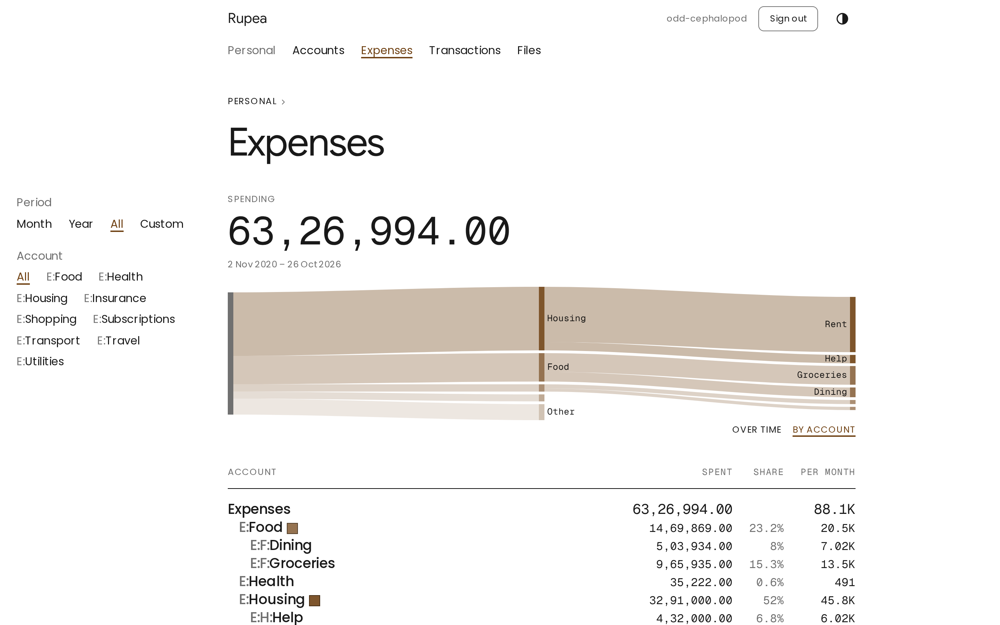

# Rupea

[](https://coveralls.io/github/SagnikPradhan/rupea?branch=master)
[](https://sonarcloud.io/summary/overall?id=rupea)

**Know where every rupee went.**

Every account, every statement, one ledger, in files you own.

> Work in progress, not ready for use.

<table>
	<tr>
		<td width="50%">
			<picture>
				<source media="(prefers-color-scheme: dark)" srcset="docs/images/expenses-dark.png">
				
			</picture>
		</td>
		<td width="50%">
			<picture>
				<source media="(prefers-color-scheme: dark)" srcset="docs/images/expenses-flow-dark.png">
				
			</picture>
		</td>
	</tr>
	<tr>
		<td width="50%">
			<picture>
				<source media="(prefers-color-scheme: dark)" srcset="docs/images/accounts-dark.png">
				
			</picture>
		</td>
		<td width="50%">
			<picture>
				<source media="(prefers-color-scheme: dark)" srcset="docs/images/investments-dark.png">
				
			</picture>
		</td>
	</tr>
	<tr>
		<td width="50%">
			<picture>
				<source media="(prefers-color-scheme: dark)" srcset="docs/images/transactions-dark.png">
				
			</picture>
		</td>
		<td width="50%">
			<picture>
				<source media="(prefers-color-scheme: dark)" srcset="docs/images/postings-dark.png">
				
			</picture>
		</td>
	</tr>
	<tr>
		<td width="50%">
			<picture>
				<source media="(prefers-color-scheme: dark)" srcset="docs/images/lots-dark.png">
				
			</picture>
		</td>
		<td width="50%">
			<picture>
				<source media="(prefers-color-scheme: dark)" srcset="docs/images/files-dark.png">
				
			</picture>
		</td>
	</tr>
</table>

## Quick start

```sh
pnpm install
cp .env.example .env
pnpm dev
```

The first run downloads the ML models for statement import into `data/models`. How to use Rupea is in the [manual](docs/manual/README.md).

## Development

```sh
pnpm models
pnpm test
pnpm test:e2e
pnpm check
pnpm lint
```

Domain terms are in [GLOSSARY.md](GLOSSARY.md), decisions in [docs/adr](docs/adr), plans in [ROADMAP.md](ROADMAP.md).

## License

[MIT](LICENSE)
