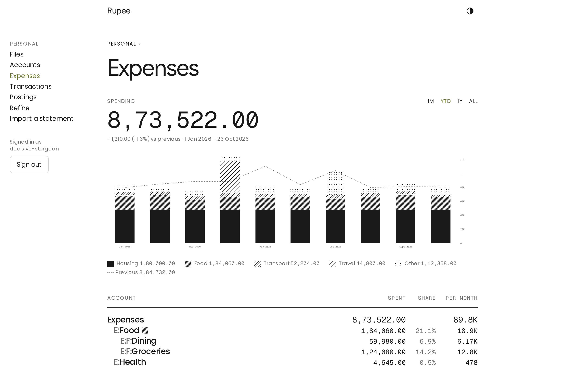
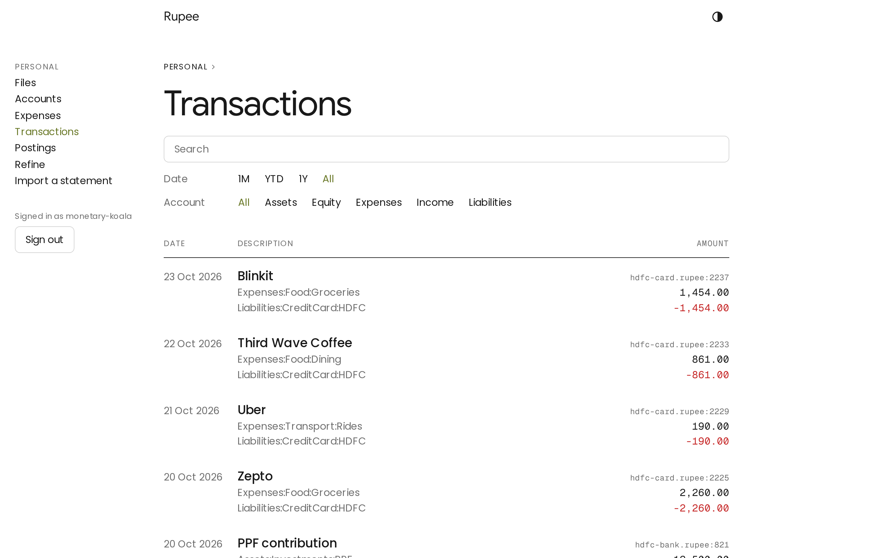
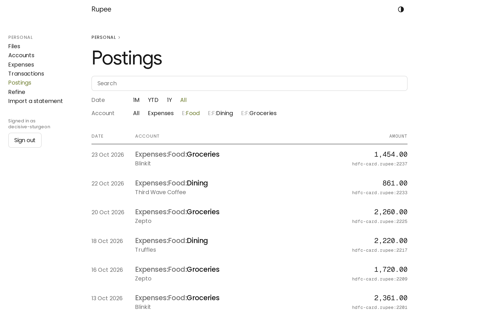
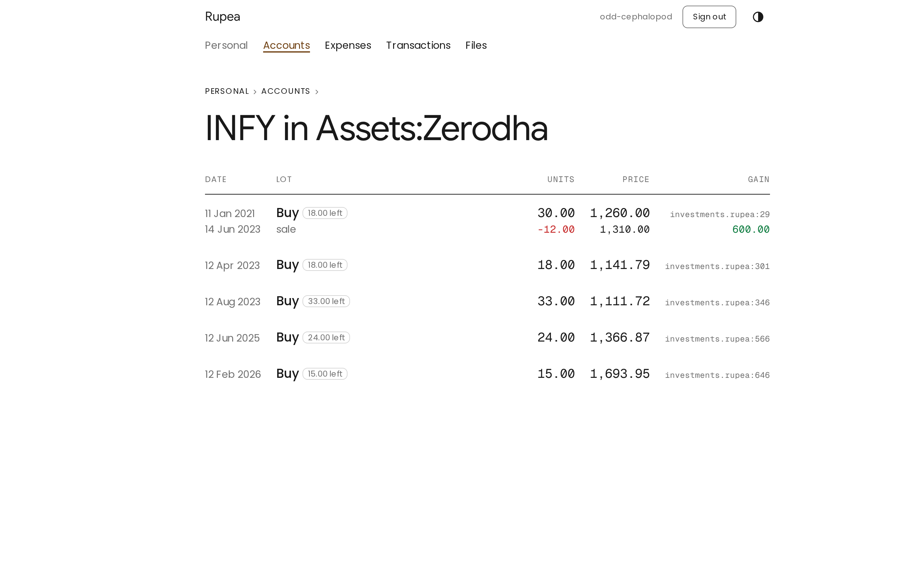
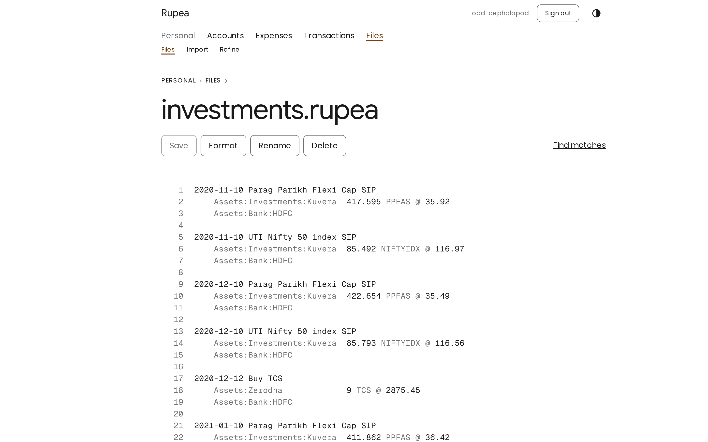

# Rupee

[](https://coveralls.io/github/SagnikPradhan/rupee?branch=master)
[](https://sonarcloud.io/summary/overall?id=SagnikPradhan_rupee)

**Know where every rupee went.**

Every account, every statement, one ledger, in files you own.

> Work in progress, not ready for use.

<table>
	<tr>
		<td width="50%">
			<picture>
				<source media="(prefers-color-scheme: dark)" srcset="docs/images/expenses-dark.png">
				
			</picture>
			<p align="center">Where the money went, month by month</p>
		</td>
		<td width="50%">
			<picture>
				<source media="(prefers-color-scheme: dark)" srcset="docs/images/accounts-dark.png">
				
			</picture>
			<p align="center">Net worth, and what each account holds</p>
		</td>
	</tr>
	<tr>
		<td width="50%">
			<picture>
				<source media="(prefers-color-scheme: dark)" srcset="docs/images/transactions-dark.png">
				
			</picture>
			<p align="center">Every transaction, searchable</p>
		</td>
		<td width="50%">
			<picture>
				<source media="(prefers-color-scheme: dark)" srcset="docs/images/postings-dark.png">
				
			</picture>
			<p align="center">Postings, narrowed to one account</p>
		</td>
	</tr>
	<tr>
		<td width="50%">
			<picture>
				<source media="(prefers-color-scheme: dark)" srcset="docs/images/lots-dark.png">
				
			</picture>
			<p align="center">Lots, with the gain on each sale</p>
		</td>
		<td width="50%">
			<picture>
				<source media="(prefers-color-scheme: dark)" srcset="docs/images/files-dark.png">
				
			</picture>
			<p align="center">Plain-text ledger files you own</p>
		</td>
	</tr>
</table>

## Quick start

```sh
pnpm install
cp .env.example .env
pnpm dev
```

The first run downloads the ML models for statement import into `data/models`. How to use Rupee is in the [manual](docs/manual/README.md).

## Development

```sh
pnpm models
pnpm test
pnpm test:e2e
pnpm check
pnpm lint
```

Domain terms are in [GLOSSARY.md](GLOSSARY.md), decisions in [docs/adr](docs/adr), plans in [ROADMAP.md](ROADMAP.md).

## License

[MIT](LICENSE)
